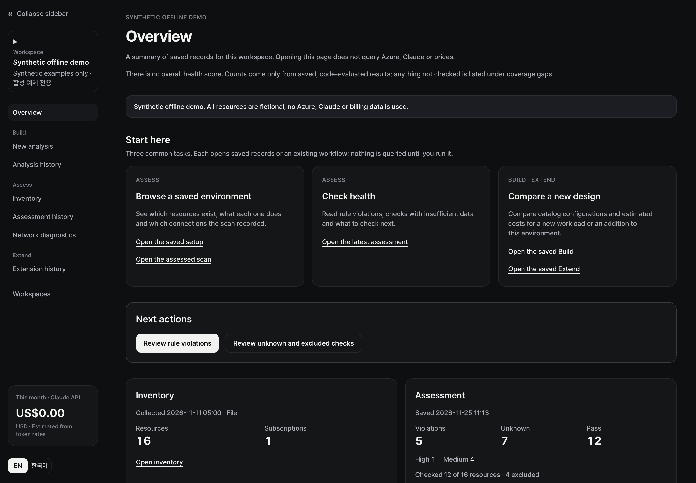
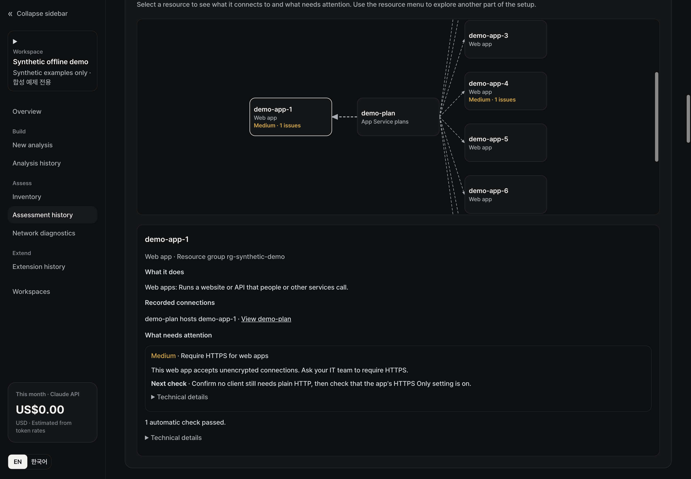
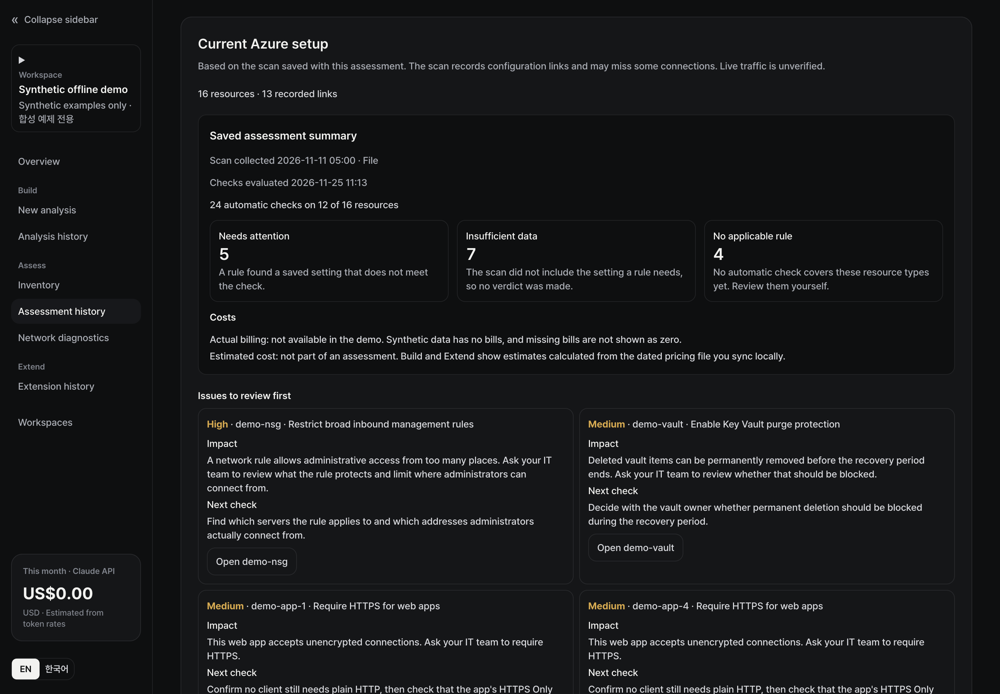

# CloudMaru

[English](README.md) · **한국어**

CloudMaru는 내 컴퓨터에서 Azure 환경을 점검하고 새 구성을 비교하는 도구입니다.
어떤 리소스가 있고 어떻게 연결되어 있는지, 무엇부터 확인해야 하는지 볼 수 있습니다.
앱의 기본 언어는 영어이며 한국어로 바꿔 같은 결과를 볼 수 있습니다.

공개 저장소는 `gunkr-com/cloudmaru`입니다. 프로젝트 코드는 MIT 라이선스를 따르며
`CLOUDSIGHT_*` 환경 변수 이름과 기존 데이터 경로를 사용합니다.

## 계정 없이 데모 시작하기

Node.js 24와 npm이 필요합니다.

```sh
npm ci
npm run demo
```

이 명령은 새 합성 데이터 폴더를 만들고, 빌드가 없으면 앱을 빌드합니다.
`127.0.0.1`에서 빈 포트로 실행한 뒤 개요 화면 주소를 출력합니다.
데모는 별도의 데이터 폴더를 사용하며 기존 설정의 데이터베이스와 비밀 값을 읽지 않습니다.
Azure나 Claude 계정 없이 점검, 구성 비교, 확장, 네트워크 진단 결과를 볼 수 있습니다.
종료하려면 Ctrl+C를 누르세요.



### 둘러보기

1. **개요 → 여기서 시작**에서 저장된 환경, 상태 점검, 새 설계 비교 중 하나를 선택합니다.
2. **현재 Azure 구성**에서는 리소스 역할이나 이름으로 찾아보고, 각 리소스의 역할과
   스캔에 기록된 연결을 확인합니다. Azure 리소스 ID와 판정 근거는 기술 세부 정보에서 볼 수 있습니다.

   

3. **저장된 점검**에서는 확인이 필요한 항목, 데이터가 부족한 항목, 적용 규칙이 없는
   항목을 구분합니다. 우선 확인할 항목마다 영향과 다음 확인 사항이 표시됩니다.

   

4. **저장된 Build와 Extend**에서 새 구성안 세 가지와 비용을 비교하거나,
   기존 환경에 추가할 리소스와 재사용 후보를 확인합니다. 데모 비용은 합성 가격으로 계산합니다.
5. **점검 보고서**를 열어 인쇄하거나 PDF로 저장할 수 있습니다. 인쇄는 Letter 용지와
   배율 100%를 기준으로 합니다. 저장된 보고서를 여는 과정에서 점검을 다시 실행하지 않습니다.

[데모 상세 안내(영어)](docs/DEMO.md)

## 세 가지 작업 모드

| 모드 | 할 수 있는 일 |
| --- | --- |
| Assess (점검) | 저장된 인벤토리, 규칙 판정, Azure Advisor 적용 범위, 실제 청구 비용, 변경 사항, 네트워크 경로를 확인합니다. |
| Build (신규 구축) | 새 아키텍처 세 가지와 예상 월 비용을 비교합니다. |
| Extend (기존 환경 확장) | 추가 구성과 재사용 후보를 비교하고, 구축 가이드와 Bicep 초안을 생성합니다. |

## 로컬 설치

Node.js 24와 npm을 준비하고 저장소를 내려받은 폴더에서 실행하세요.

```sh
npm ci
cp .env.example .env.local
npm run build
npm run start -- --port 3180
```

[로컬 설정 화면](http://127.0.0.1:3180)을 열어 설정을 완료하세요. 기본 데이터 경로는
`~/.cloudsight/data`입니다. 실행 인스턴스마다 별도의 데이터 폴더를 사용하세요.

Azure 직접 조회에는 읽기 전용 권한을 가진 Azure 연결을 등록합니다. Resource Graph
JSON을 가져오면 Azure나 AI 연결 없이 로컬 규칙으로 점검할 수 있습니다.
AI 기능에는 본인의 Anthropic API 키가 필요합니다. 기능을 실행하면 필요한 정보만 추려 비밀 값을 가린 뒤 Anthropic으로 전송합니다.
비용은 해당 API 계정에 청구됩니다.

실제 Build와 Extend 견적을 계산하려면 `npm run prices:sync`를 실행해 로컬 CAD
가격표를 준비하세요. 가격 기준일은 결과에 표시됩니다.

[설치와 운영(영어)](docs/SELF_HOSTING.md) · [백업과 복원(영어)](docs/BACKUP_RESTORE.md) · [비밀 값 저장(영어)](docs/SETUP_DESIGN.md) · [보고서와 인쇄(영어)](docs/REPORT_DESIGN.md)

## 데이터와 결과

Azure 호출은 읽기 전용입니다. 점검 판정과 비용 계산은 코드가 수행하고, AI는 검증된
카탈로그의 구성요소를 선택합니다. 실제 청구액과 예상 비용을 구분해 표시합니다.
네트워크 진단은 저장된 구성으로 경로를 판단합니다. Bicep 결과물은 배포 전 검토가 필요한
초안입니다.

저장 결과는 당시 근거와 가격 기준을 보존합니다. 다시 열거나 다운로드할 때 모델을
호출하거나 Azure를 재조회하지 않습니다. PGlite 데이터베이스를 복사하기 전에 앱을
종료하세요. Docker Compose는 Linux 호스트 네트워크에서 로컬 주소로 실행합니다.
원격 접근에는 SSH 터널이나 비공개 프록시를 사용하세요. 앱은 1인 운영용이며
공개 웹 서비스에 필요한 인증 기능이 없습니다.

## 개발과 검증

```sh
npm run lint
npm run build
npm run test -- --maxWorkers=2
python3 -m pytest scripts/ -q
```

Extend의 컴파일러 테스트에는 [설치 문서](docs/SELF_HOSTING.md)에 명시된 Bicep 버전이
필요합니다. 테스트, 스크린샷, 이슈, 데모에는 합성 데이터와 예시 값만 사용하세요.

## 라이선스

프로젝트 코드는 [MIT](LICENSE)를 따릅니다. 의존성, 글꼴, 참고 자료에는 각자의
[라이선스와 고지](THIRD_PARTY_NOTICES.md)가 적용됩니다.

[영어 README로 돌아가기](README.md)
