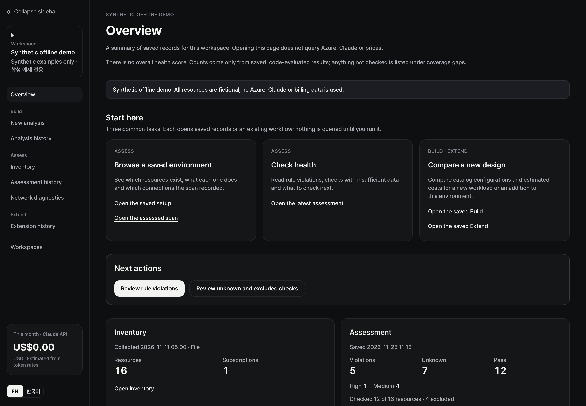
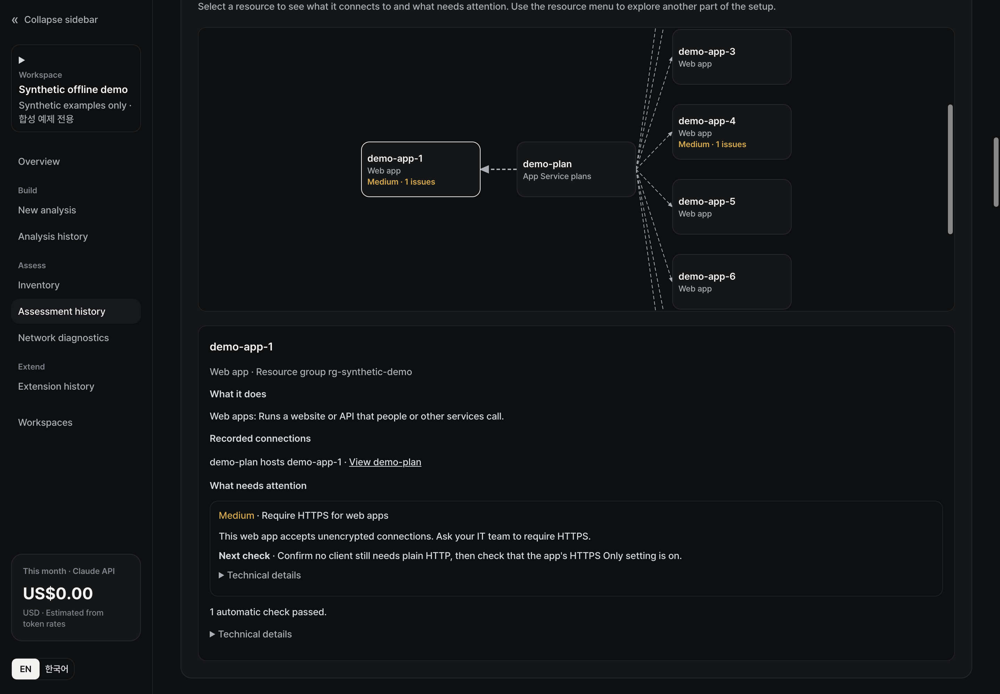
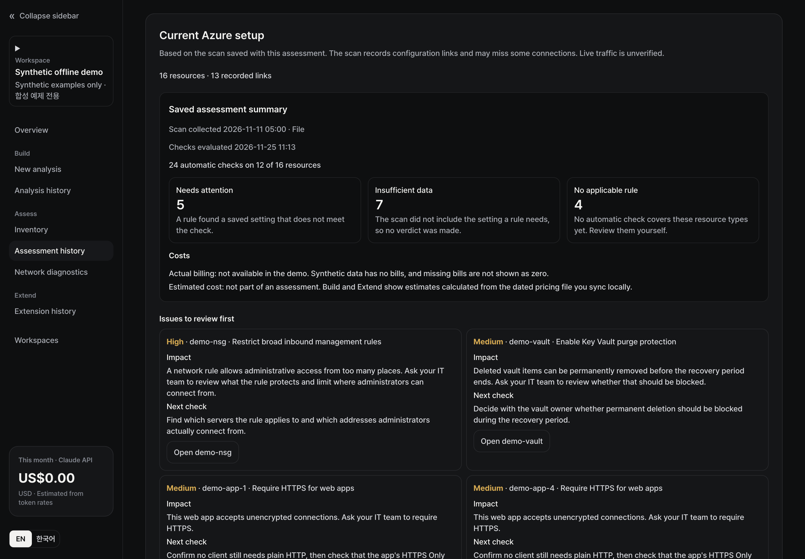

# CloudMaru

**English** · [한국어](README.ko.md)

See what an Azure environment contains, which connections were recorded and
what to check first — then compare new designs — on your own machine.

The public repository is `gunkr-com/cloudmaru`. The source uses the MIT license
and retains the `CLOUDSIGHT_*` environment names and existing data paths.
Estimates in live Build and Extend use a dated price file you sync locally with
`npm run prices:sync`. The offline demo uses synthetic pricing.

## Try it in one command (no Azure or Claude account)

Requires Node.js 24 and npm.

```sh
npm ci
npm run demo
```

The command creates a fresh synthetic data folder, builds the production app
once if no build exists, starts it on `127.0.0.1` with a port chosen by the
operating system, and prints `Open: http://127.0.0.1:<port>/overview`. All
resources are fictional. The app server receives none of your dotenv values
(such as `.env.local`); the launcher only learns their names to blank them. It
never opens your configured data folder and makes no Azure, Claude or billing
requests.
Press Ctrl+C to stop.



### Walkthrough

1. **Overview → Start here.** Three cards: *Browse a saved environment*,
   *Check health* and *Compare a new design*. Choose **Open the saved setup**.
2. **Current Azure setup.** Use the role filter controls (*All roles*,
   *Web apps*, *App Service plans* …) or *Find a resource* to open a web app,
   its App Service plan and the storage account. The panel reads: what it
   does → recorded connections → what needs attention. Azure IDs and rule
   evidence stay under *Technical details*.

   

3. **First checks.** Back on Overview, choose **Open the latest assessment**.
   The saved assessment summary shows the scan time, how many automatic
   checks ran, and separate counts for *Needs attention*, *Insufficient data*
   and *No applicable rule*. Each issue to review first has an impact and a
   next check. Actual billing is labeled as not available in the demo.

   

4. **Saved Build and Extend.** On Overview, *Compare a new design* has
   **Open the saved Build** (three catalog configurations with estimated
   costs) and **Open the saved Extend** (additions to the synthetic
   environment, reuse candidates and incremental estimates).
5. **Assessment report.** On the assessment page, the **Assessment report**
   link opens the saved report. Use **Print / save PDF**; the layout targets
   Letter at 100% scale. Printing does not rerun checks or call AI or Azure.

Switch English/Korean at any time; the same saved data reopens. Screenshots
come from the synthetic demo only. Details and limits:
[demo walkthrough](docs/DEMO.md).

## About

A self-hosted, single-operator Azure assessment and architecture planning tool.
Bring your own Azure read-only identity and Anthropic API key. English and
Korean are included; estimates use dated CAD price snapshots.

| Mode | What you can do |
| --- | --- |
| Assess | Inspect saved inventory, rule findings, Advisor coverage, actual costs, changes, and network paths. |
| Build | Compare three new architecture options and estimated monthly costs. |
| Extend | Compare additions to existing infrastructure, reuse eligible resources, and generate draft guides and Bicep. |

## Start locally

Requires Node.js 24 and npm. Install in your own checkout with a dedicated
data directory. No developer account, sample key, or login is bundled.

```sh
npm ci
cp .env.example .env.local
npm run build
npm run start -- --port 3180
```

Open <http://127.0.0.1:3180> and follow setup. The `.env.example` default
data location is `~/.cloudsight/data`; use a separate directory for every
running installation. Register your own Claude key through the local setup
screen or use a dedicated workspace environment variable. Keys are held on
the server and are never returned by the settings UI.

Azure connection is optional: you can import Resource Graph JSON and use
local rule checks without an AI key. AI features send minimized, redacted
context to Anthropic and incur charges on your own API account. Connecting
a key does not establish your organization's data handling approval.

## Seed synthetic examples only

`npm run demo` (above) is the usual entry. To create the synthetic data
folder without starting a server, run `npm run demo:seed`; it prints a newly
allocated temporary data directory and example URLs. See
[demo walkthrough](docs/DEMO.md).

## Install and operate

- [Local and Linux server installation](docs/SELF_HOSTING.md)
- [Backup, restore, and upgrades](docs/BACKUP_RESTORE.md)
- [Settings and secret storage](docs/SETUP_DESIGN.md)
- [Reports and print layout](docs/REPORT_DESIGN.md)
- [Public source preparation](docs/PUBLIC_RELEASE.md)

Docker Compose targets Linux host networking so the app remains on
`127.0.0.1`. Use the native Node instructions on macOS. Access a remote
server with an SSH tunnel or a private access proxy; the app has no
multi-user authentication and must not be exposed as an open web service.

## Data and result boundaries

Azure requests are read-only. Verdicts and cost arithmetic are code-owned;
AI chooses only catalog-backed content. `Unknown`, unsupported coverage,
missing costs, and actual versus estimated spend remain distinct. Static
network diagnosis is not a live connectivity test. Bicep is a draft: local
compilation does not establish Azure deployment feasibility.

Saved results retain their original evidence and price basis. Reopening or
downloading them does not call the model, refresh prices, or rescan Azure.
Stop an installation before copying its PGlite database. Never run two
servers against the same data directory.

## Development

```sh
npm run lint
npm run build
npm run test -- --maxWorkers=2
python3 -m pytest scripts/ -q
```

Real Extend compiler tests require the exact Bicep version documented by
the app. Production containers install and checksum that pinned compiler.
Do not use real tenant exports, credentials, or company observations in
tests, screenshots, issues, or demo content.

## License

Project code: [MIT](LICENSE). Dependencies and fonts retain their own
[licenses and notices](THIRD_PARTY_NOTICES.md). Azure and Microsoft names
identify third-party services; this project does not imply endorsement.
